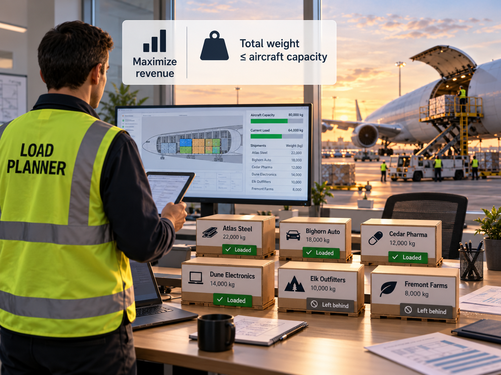

# sefop-sctc-2026

**Airlines Optimization Workshop: industry best practices for a decision-support system.**
3rd Annual Southern Colorado Transportation Conference (SCTC 2026), Colorado State University Pueblo.

[](LICENSE)
[](https://www.python.org/)
[](https://github.com/sefop/sefop-sctc-2026/actions/workflows/ci.yml)


## Installation instructions

1. Clone the repository and move into its folder:

   ```bash
   git clone https://github.com/sefop/sefop-sctc-2026.git
   cd sefop-sctc-2026
   ```

2. Create a virtual environment with Python 3.12 and activate it.

   On Windows:

   ```bash
   py -3.12 -m venv .venv
   .venv\Scripts\activate
   ```

   On macOS or Linux:

   ```bash
   python3.12 -m venv .venv
   source .venv/bin/activate
   ```

3. Install the requirements:

   ```bash
   pip install -r requirements.txt
   ```

4. Plan the workshop flight:

   ```bash
   python -m cli optimize_cargo SC101
   ```

   You should see:

   ```text
   Flight SC101   weight limit 1,000 kg

   Shipment  Customer          Weight  Revenue  Decision
   --------  ----------------  ------  -------  -----------
   S1        Atlas Steel       300 kg   $3,000  LOADED
   S2        Atlas Steel       250 kg   $2,400  LOADED
   S3        Atlas Steel       200 kg   $1,900  LOADED
   S4        Bighorn Auto      250 kg   $2,300  LOADED
   S5        Bighorn Auto      150 kg   $1,300  left behind
   S6        Cedar Pharma      100 kg     $800  left behind
   S7        Dune Electronics  150 kg   $1,100  left behind
   S8        Elk Outfitters    100 kg     $700  left behind
   S9        Fremont Farms     200 kg   $1,200  left behind

   Shipments      4 loaded, 5 left behind
   Revenue        $9,600
   Weight used    1,000 of 1,000 kg
   ```

   `python -m cli optimize_cargo SC001` plans a three-shipment flight small enough to check by hand.

5. Run the tests. They finish in about a second; add `-v` to read their names, which are written
   as sentences a planner would recognize.

   ```bash
   pytest
   ```

## Business problem

<p align="center">
  
</p>

A cargo flight has more shipments waiting than it can carry. A load planner decides which ones
fly. Each shipment belongs to a customer, has a weight, and earns a revenue if it flies. The
aircraft can carry only so much weight, and that limit is physical: it is never exceeded.

The program supports that decision. It recommends the load that earns the most revenue; the
planner makes the final call.

In the output above, the aircraft is full and revenue is as high as it can be. Look at the Customer
column, though: four customers have nothing on this flight. That observation is where the workshop
starts.

**What the planner gives the program.** One folder per flight under `data/`, each holding a
`data.json`:

```json
{
  "flightId": "SC101",
  "maxWeightKg": 1000,
  "shipments": [
    { "id": "S1", "customer": "Atlas Steel", "weightKg": 300, "revenueUsd": 3000 }
  ]
}
```

To plan your own flight, copy a folder, rename it, edit the file, and pass the folder's name to
`optimize_cargo`. The flights, customers and numbers here are invented for the workshop.

**What the program answers.**

| Situation | What you see | Exit code |
| --- | --- | --- |
| A load was chosen | The table above | 0 |
| The data is fine, but every shipment alone is heavier than the weight limit | `No shipment fits on this flight: ...` | 1 |
| The data is missing or wrong | `Cannot plan this flight: ...` followed by what to correct | 2 |

A shipment that alone is heavier than the weight limit is marked `left behind (over weight limit)`,
to tell it apart from a shipment that fits but lost out to more valuable cargo.

**A planner would not use a terminal.** A terminal is enough to follow one business request from
the planner's words to a tested program, which is what the workshop does. A screen for the planner
is a presentation requirement for a later version;
[`sefop-python-advanced`](https://github.com/sefop/sefop-python-advanced) shows the same ideas
behind a web application.

## Mathematical model

This problem can be formulated as a classical 0/1 knapsack problem. Given a flight, the program
returns the set of shipments that maximizes revenue without exceeding the aircraft's weight limit.

### Sets

- $I$: the shipments waiting for the flight. The index $i$ runs over it.

### Parameters

Assume all these are deterministic.

For each shipment $i \in I$:

- $r_i > 0$: the revenue earned if the shipment flies, in USD.
- $w_i > 0$: the weight of the shipment, in kg.

For the aircraft:

- $W > 0$: the maximum weight the aircraft may carry, in kg.

### Variables

- $x_i \in \lbrace 0, 1 \rbrace$: 1 if shipment $i$ flies, 0 if it is left behind, for each $i \in I$.

### Objective function

Maximize revenue:

$$
\max_{x} \quad \sum_{i \in I} r_i x_i
$$

### Constraints

**(C1) Weight limit.** The loaded shipments weigh no more than the aircraft may carry.

$$
\sum_{i \in I} w_i x_i \le W
$$

**(C2) Whole shipments.** A shipment flies whole or not at all.

$$
x_i \in \lbrace 0, 1 \rbrace \qquad \forall i \in I
$$

Put together, the complete model reads:

$$
\begin{aligned}
\max_{x} \quad & \sum_{i \in I} r_i x_i \\
\text{s.t.} \quad & \sum_{i \in I} w_i x_i \le W & \text{(C1) weight limit} \\
& x_i \in \lbrace 0, 1 \rbrace \quad \forall i \in I & \text{(C2) whole shipments}
\end{aligned}
$$


### Notation

| Symbol | Type      | Meaning                               | Unit | Domain                           |
| :----: | --------- | ------------------------------------- | ---- | -------------------------------- |
|  $I$   | set       | shipments waiting for the flight      | —    | finite set                       |
|  $i$   | index     | one shipment                          | —    | $i \in I$                        |
| $r_i$  | parameter | revenue earned if shipment $i$ flies  | USD  | $r_i > 0$                        |
| $w_i$  | parameter | weight of shipment $i$                | kg   | $w_i > 0$                        |
|  $W$   | parameter | maximum weight the aircraft may carry | kg   | $W > 0$                          |
| $x_i$  | variable  | whether shipment $i$ flies            | —    | $x_i \in \lbrace 0, 1 \rbrace$   |

### An example instance

Flight `SC001`, in `data/SC001/data.json`:

| Shipment         | Weight $w_i$ | Revenue $r_i$ |
| ---------------- | :----------: | :-----------: |
| S1: Atlas Steel  |     500      |     3000      |
| S2: Bighorn Auto |     250      |     2000      |
| S3: Cedar Pharma |     250      |     1800      |

with $W = 500$ kg:

$$
\begin{aligned}
\max_{x} \quad & 3000 x_1 + 2000 x_2 + 1800 x_3 \
\text{s.t.} \quad & 500 x_1 + 250 x_2 + 250 x_3 \le 500 \
& x_1, x_2, x_3 \in \lbrace 0, 1 \rbrace
\end{aligned}
$$

S1 is the most valuable shipment, but it fills the aircraft alone and earns 3,000 USD. S2 and S3
fit together and earn 3,800 USD. The optimal solution is $x_1 = 0$, $x_2 = 1$, $x_3 = 1$:

| Value       | Computed as                                  |     Result      |
| ----------- | -------------------------------------------- | :-------------: |
| Revenue     | $3000 \cdot 0 + 2000 \cdot 1 + 1800 \cdot 1$ |    3,800 USD    |
| Weight used | $500 \cdot 0 + 250 \cdot 1 + 250 \cdot 1$    | 500 of 500 kg   |

`python -m cli optimize_cargo SC001` reproduces it.

## Repository structure

```text
src/
├── cli.py            reads the command line and hands over to startup.py
├── startup.py        the only place where concrete parts are assembled
├── domain/           Shipment, Flight, Load: the planner's vocabulary, with its rules
├── use_cases/
│   ├── use_case_optimize_cargo.py    load a flight, choose a load, report the outcome
│   ├── optimization_response.py      the three possible outcomes
│   ├── ports/                        what the use case needs from the outside world
│   └── solving/                      preprocessing -> solver -> postprocessing
│       └── optimization/
│           ├── mip_highs/            the model, written for the HiGHS solver
│           └── enumeration/          tries every load; the reference the tests compare against
└── adapters/         reading JSON, printing the table
tests/                mirrors src/, plus end-to-end situations under tests/resources/
data/                 one folder per flight
```

The layout follows [`sefop-python-starter`](https://github.com/sefop/sefop-python-starter), with
fewer parts. Dependencies point inward: `adapters/` knows about `use_cases/`, never the reverse, and
`domain/` knows about nothing else.

The solver's answer is trusted because, on small flights, it earns exactly the same revenue as
trying every possible load one by one
(`tests/use_cases/solving/optimization/test_providers_agree_with_enumeration.py`).

To change the code, run all three checks before committing. The installation already brought in
the formatter and the type checker:

```bash
black src tests    # format
mypy               # check the type hints
pytest             # run the tests
```
